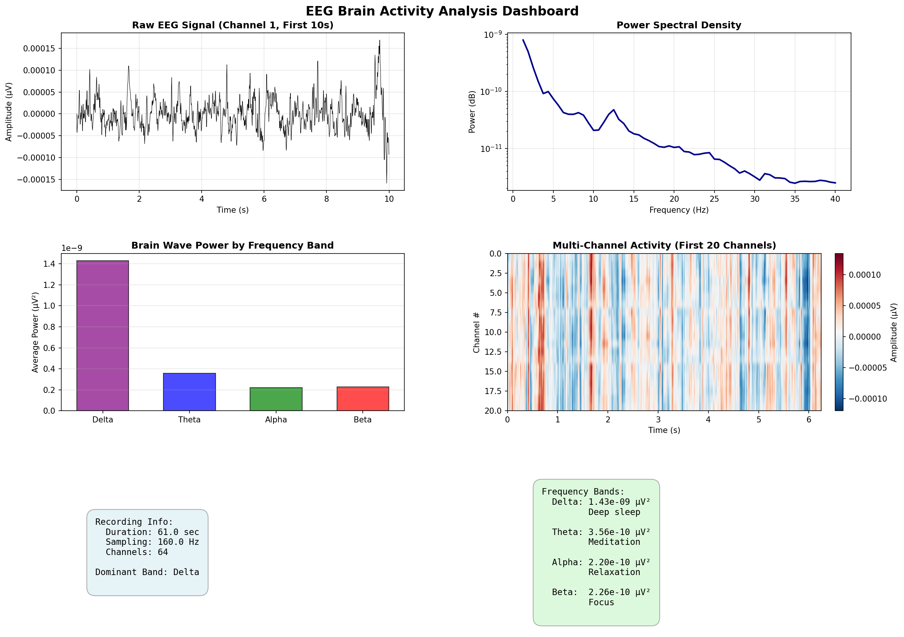

# eeg-pipeline

A python pipeline for processing and visualizing electroencephalography (EEG) recordings. The aim of this project is to explore brain activity and use signal preprocessing, frequency-band analysis, and generate visualizations of EEG signals. 

## Features
- **EEG Data Acquisition:** Downloads real EEG recordings from Physionet EEG Motor Movement/imagery dataset using MNE-Python
- **Signal Preprocessing:** Applies bandpass filtering to prepare EEG signals for analysis
- **Frequency Analysis:** Extracts and analyzez delta, theta, alpha, and beta frequency bands
- **Data Visualization:** Generates power spectral density plots and multi-channel heatmaps to model signal characteristics across 64 EEG channels

## Tool & Technologies
- Python
- MNE-Python
- NumPy
- Matplotlib

## Data
This project uses the [EEG Motor Movement/Imagery](https://physionet.org/content/eegmmidb/1.0.0/) Dataset hosted by PhysioNet.

This data contains EEG recordings collected during motor movement and motor imagery experiments.
The download script retrieves subject 1, run 1 for analysis.

## How to run

- Python 3.10 or newer
- Git
- Strong internet connection to download the dataset

1. Clone the repository
```
git clone https://github.com/altikritimatwit/eeg-pipeline.git
cd eeg-pipeline
```

2. Create a virtual environment
```
python -m venv .venv
```

On Windows:
```
.\.venv\Scripts\Activate.ps1
```

On macOS or Linux:
```
source .venv/bin/activate
```

3. Install dependencies 
```
python -m pip install --upgrade pip
python -m pip install -r requirements.txt
```

4. Download EEG data
```
python download_data.py
```

5. Run the analysis
```
python dashboard.py # for summary 
python ingest.py # for data information
python features.py # for frequency bands plot + powers
python preprocessing.py # for pre/post processing comparison
```

## Example Visualizations

